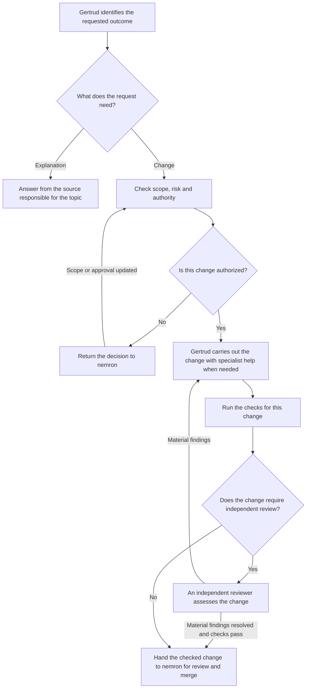

# Contributing

Thank you for contributing to ai4X.

## How a request becomes a contribution

[Team routing](.ai4x/TEAM.md) defines specialist and independent review triggers. [Work authority](.ai4x/governance/work-authority.md) defines what each approval covers and reserves the merge into `trunk` for the Product Owner.

## Before changing code

1. Read `.ai4x/BEHAVIOR.md` and `.ai4x/CONTEXT.md`.
2. Confirm the intended outcome and acceptance criteria. Follow [work authority](.ai4x/governance/work-authority.md#risk-paths) to determine when a Ready Issue is required.
3. Load only the context, source, tests, and documentation needed for the change.

## Delivery

- Branch from current `trunk` using `feat/*`, `fix/*`, `docs/*`, `chore/*`, or `refactor/*`.
- Keep one coherent, reviewable change per pull request.
- Add tests in proportion to behavior and risk.
- For changes confined to [CI’s documentation paths](.github/workflows/verify.yml), run `make structure-check licensing-check` and `git diff --check`. For technical, mixed or uncertain changes, run `make verify`. Exercise any changed entry behavior according to the [Cold Start rule](.ai4x/governance/cold-start-verification.md).
- Use clear Conventional Commit messages and squash merge.
- Update documentation when a public contract changes.

Repository checks and evidence support human review; they do not replace it.
See [GOVERNANCE.md](GOVERNANCE.md) for the lean decision and board model.

## Licensing

Submit only material you are authorized to license. Preserve notices and follow
the path assignments in [REUSE.toml](REUSE.toml) and [LICENSING.md](LICENSING.md).
