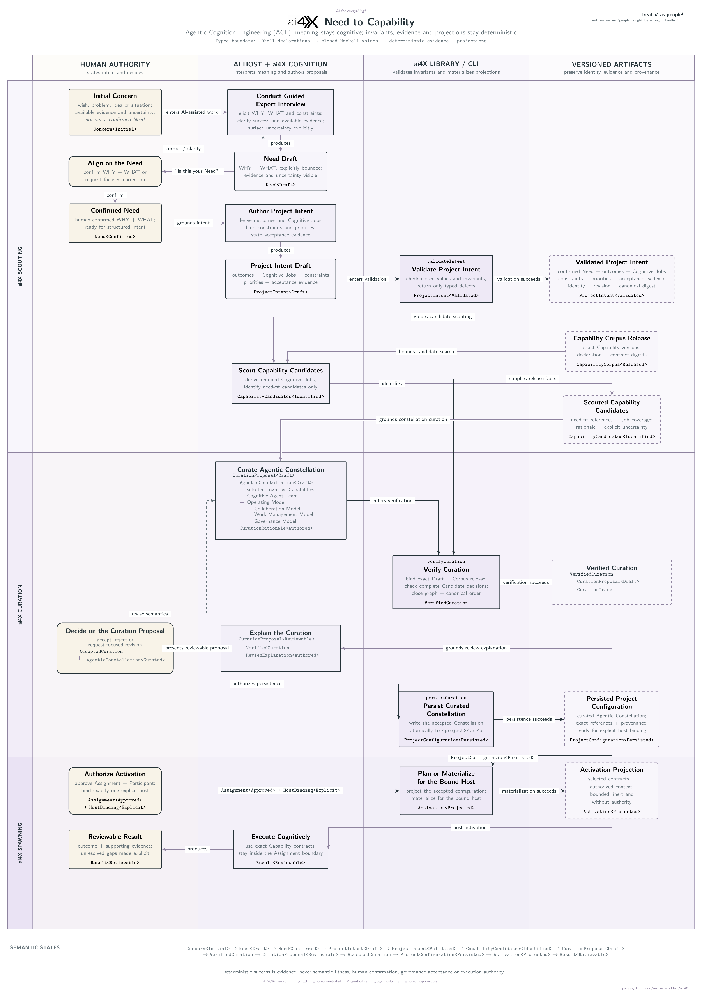

  

  <em>From human intent to fit-for-purpose Agentic Constellations.</em>

  

# Purpose

## Why

I believe that insight work must be understandable, reproducible, and kept under explicit control if people are to have an honest good time together (`#hgtt`).

Decisions, outcomes, and changes should be understood, reviewed, and owned together.

## How

The needs along the insight chain are diverse: putting data into context, deriving reliable information from it, connecting information into knowledge, and turning knowledge into insight.

Different situations require different capabilities.

For that, I provide an operating frame in which cognitive capabilities can be curated consistently and fit for purpose, so that teams can arrive at reliable insights in a transparent and reviewable way.

## What

Such an operating frame needs clear responsibilities, binding contracts, and a robust separation between the operating framework, runtime orchestration, and cognitive capabilities.

With **ai4X**, I provide a *reproducible operating model for agentic AI development and operations*. ai4X deliberately separates the operating framework, runtime orchestration, behavior curation, and the source-of-truth layers for cognitive capabilities. The result is reproducible, reviewable, and team-scalable AI workflows instead of isolated, hard-to-control one-off solutions.

> [!IMPORTANT]
> **ai4X** is a fit-for-purpose, consistent curation of cognitive capabilities for insight generation.

To put those capabilities to work, people decide what each agent will do.

# Design Principles

> **Treat *it* as people!**

Give agents a clear brief, ask them to explain their reasoning, and review their work. People make the final decision.

- **Need-first:** describe the outcome before selecting implementation.
- **Host-independent:** keep project and agent declarations separate from host adapters.
- **Agentic-first:** make context discoverable, bounded, and executable by AI agents.
- **Human-approvable:** make intent, effects, evidence, and decisions understandable to people.
- **Self-applicable:** evolve ai4X using the same Need-to-Capability discipline it provides.

# From Need to Capability

The diagram shows how ai4X is designed to turn a human need into an **Agentic Constellation**: a team of agents, the capabilities they need, and a way to work together.

  

  Open the diagram for the full-size architecture view. Publication source: <a href="doc/system-design/need-to-capability/need-to-capability.tex">TikZ</a>.

This is the design for the first ai4X release. People confirm the need, review the proposed constellation and decide when to activate it. The [Need-to-Capability design](doc/system-design/need-to-capability/README.md) explains how scouting, curation and activation fit together in agentic cognition engineering (ACE).

# Explore ai4X

- [See how a team compares competing pitches](doc/use-cases/pitch-assessment.md) · [Browse the documentation](doc/README.md)
- [Contribute to ai4X](CONTRIBUTING.md) · [How decisions are made](GOVERNANCE.md)

# License

ai4X uses [CC BY 4.0 and Apache-2.0](./LICENSING.md) according to file path.
The license overview and [REUSE.toml](./REUSE.toml) identify the license for each tracked file.

© 2026 [nemron](https://github.com/normenmueller)
